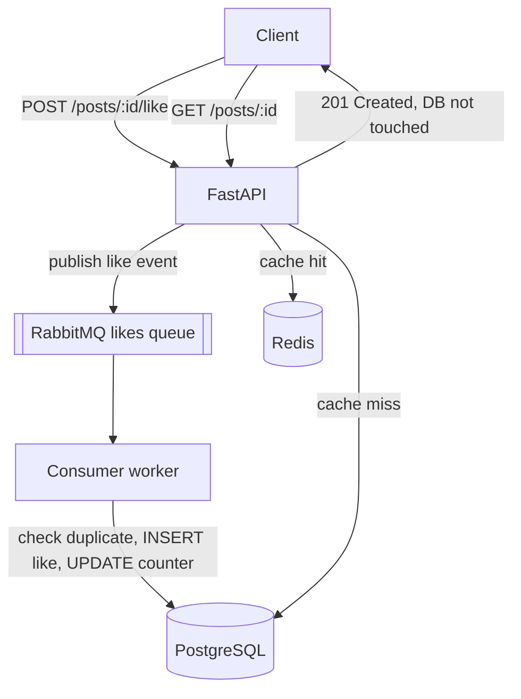

# Echo: surviving the "like storm"

A microblog backend built as a **high-load lab**: users publish short posts, read them, and like them.
The point of the project is not the CRUD, it is the question *"what happens when one popular post gets
thousands of likes per second, and what does each piece of infrastructure actually buy you?"*

I built it in four steps and load-tested every step with the same scenarios, so the effect of each
technology is measured rather than assumed.


## TL;DR

| Step | What changed | **Like storm** @ 200 users | **Mixed traffic**, peak RPS |
|---|---|---|---|
| 1. Baseline | Everything in PostgreSQL: a like is a synchronous `INSERT` + `likes_count = likes_count + 1` inside the request | 127 RPS, p95 3.5 s | ~200 |
| 2. + Redis cache | Read cache for `GET /posts/:id` and `/feed/top`; the cache is invalidated on every like | 106 RPS, p95 4.4 s | ~240 |
| 3. + RabbitMQ | API publishes the like to a queue and returns without touching the database; a background worker writes it | **413 RPS, p95 310 ms** | ~330 |
| 4. + 3 consumers | Same, with three worker processes | 339 RPS, p95 460 ms | ~310 |

- A read cache lifted mixed throughput by ~20% and halved read latency, but **did nothing for writes** —
  on the pure like storm it even cost ~16% (127 → 106 RPS), because every like now also invalidates a key.
- Moving the write off the request path gave **~3.3x throughput and ~11x lower p95** on the like storm.
- More consumers did **not** help: three workers contend for the same PostgreSQL rows, so the limit stayed
  in the database. Where the API process *was* the limit, a second uvicorn worker did help — see
  [Sizing matters](#sizing-matters).

## Architecture



**Like path.** `POST /api/v1/posts/{post_id}/like` publishes `{post_id, user_id}` to the `likes` queue
(durable queue, persistent messages) and returns `201 Created` immediately. The API neither reads nor
writes PostgreSQL and does not wait for the like to be stored. A long-running consumer takes messages
with `prefetch_count = 10`, checks whether this user has already liked the post, inserts the
`(post_id, user_id)` row, increments `likes_count`, and only then acknowledges the message.

**Read path.** `GET /posts/:id` is served from Redis (`post:{id}`, TTL 60 s); on a miss the API reads
PostgreSQL and fills the cache. `/feed/top` is cached the same way (`top:1`, TTL 20 s).

## API

| Method | Path | Description |
|---|---|---|
| `POST` | `/api/v1/posts/` | Create a post |
| `GET` | `/api/v1/posts/{post_id}` | Read a post (cached) |
| `POST` | `/api/v1/posts/{post_id}/like` | Like a post (`201 Created`, queued) |
| `GET` | `/api/v1/feed/top` | Top posts (cached) |

> The like endpoint returns `201 Created` even though the like is only queued. `202 Accepted` would be
> the more honest status code; `201` was a shortcut and is kept for consistency with the reports.

## Results

Load was generated with [Locust](https://locust.io) on the same machine as the services, using two
scenarios:

- **Mixed:** 70% post reads, 15% likes, 10% top feed, 5% post creation, spread over a set of seeded posts.
- **Like storm:** every user likes a post from the top feed with a fresh random `user_id`, which is what
  exposes row-lock contention.

Users ramp up and run for about 3 minutes per point, at 50 / 100 / 200 / 300 / 500 users
(the baseline also has a 1000-user point; not every combination exists for every version).

### Latency


*Log scale. Lines are smoothed for readability, markers are measured points.*

### Throughput


Raw numbers for every run are in [`results.csv`](results.csv).

### Sizing matters

Same mixed scenario, 500 users, only the number of processes changes:

| Configuration | RPS | avg | p95 |
|---|---|---|---|
| 1 uvicorn + 1 consumer | 321 | 1.19 s | 7.8 s |
| 1 uvicorn + 3 consumers | 282 | 1.39 s | 9.0 s |
| 2 uvicorn + 1 consumer | **437** | **0.68 s** | **1.0 s** |
| 2 uvicorn + 3 consumers | 437 | 0.68 s | 1.1 s |

Three extra consumer processes cost ~12% of throughput; one extra API process added ~36%. Two extra
consumers changed nothing. On a single machine everything competes for the same cores, so *how many
processes of which service* you run matters as much as the choice of technology.

## What I take away

1. **For a small prototype, plain FastAPI + PostgreSQL is enough.** The baseline served ~200 RPS of
   mixed traffic and ~127 likes/s with no cache and no broker.
2. **Only when the load is real do the extra pieces start to pay off** — and then each one has to be
   measured, not assumed.
3. **Redis pays off when the read is expensive.** Here reads were already cheap primary-key lookups, so
   the cache bought ~20% RPS and roughly half the read latency. It also costs on the write side:
   invalidation is an extra Redis round-trip on every like.
4. **RabbitMQ is about not making the user wait.** Return `201`/`202`, do the work in the background.
   That is the whole point when the result is not needed immediately — and the queue absorbs the burst
   instead of the database.
5. **It also gives delivery guarantees** that a `BackgroundTasks` call does not: ack/nack, requeue,
   durable queue, persistent messages, and a natural place to attach a dead-letter queue.
6. **Watch the cores.** 3 consumers + 1 uvicorn was *worse* than 1 consumer + 2 uvicorn (282 vs 437 RPS).
7. **Neither a cache nor a broker is a panacea.** Estimate the load first, then decide. Five containers
   (+ nginx) instead of two is a real operational bill.

## Design decisions and trade-offs

- **Why a queue.** Every like on a hot post updates the same row, so PostgreSQL serializes them and the
  client waits behind a row lock. The queue moves that wait out of the request, and the burst lands in
  RabbitMQ instead of the database.
- **No batching, on purpose.** This is *not* the usual "aggregate counters in memory and flush in bulk"
  design: the worker processes one message at a time. The measured gain came from getting the write off
  the request path, not from batching. Batching is the next step, not the current implementation.
- **Why no Celery.** The point was to see ack, prefetch and redelivery explicitly, without a framework
  hiding them. A plain `aio_pika` consumer is a few dozen lines.
- **Why the cache did so little.** Reads were already indexed primary-key lookups, so replacing them with
  Redis gained ~20%. A cache pays off when the query is expensive or the database is actually read-bound.
- **Why more consumers did not help.** The three consumers compete for the same rows and the same CPU as
  the API, so the limit stayed in PostgreSQL. Adding API processes is what moved the needle.
- **Delivery semantics.** Durable queue + persistent messages + ack *after* the database write means the
  system is at-least-once. The worker uses `requeue=False`, so a failed message is dropped rather than
  retried forever; a dead-letter queue is still missing.
- **Consistency.** Reads can be stale: the consumer does not invalidate `post:{id}` or `top:1`, so a
  stored like becomes visible to readers only after the TTL expires (60 s for a post, 20 s for the feed).
  This is why part of the read-speed gain came for free — the cache is never invalidated by writes.
- **Out of scope on purpose.** Auth, a users table (`user_id` is a trusted identifier), pagination.

## Known limitations

- Everything (API, PostgreSQL, Redis, RabbitMQ, Locust) ran on **one machine**, so absolute numbers are
  lower than on separate hosts and the ceiling is partly CPU contention. Compare versions with each
  other, not with other projects.
- Most points were run **once or twice**, not as a median of three. The retests disagree with the
  originals by up to 20% on the mixed 200-user point (236 vs 190 RPS), which is larger than some of the
  effects discussed here.
- The baseline mixed 200-user point (138 RPS vs 194 at 100 users) looks like an outlier and was not re-run.
- With the queue enabled, the mixed scenario shows `500` errors on read endpoints at 300+ users
  (about 1.3% at 300, 2.7% at 500). The cause is not yet identified (suspected connection pool).
- In the mixed scenario, like requests stay slow (seconds) even with the queue, unlike in the like-only
  scenario. Under investigation; the prime suspect is the single shared RabbitMQ channel used for all
  publishes.
- No metrics were collected (queue depth, pool usage, Redis hit ratio), so bottlenecks are inferred from
  latency shapes rather than observed.

## Tech stack

| Layer | Technologies |
|---|---|
| API | Python, FastAPI, Pydantic |
| Database | PostgreSQL, SQLAlchemy 2.0 (async), asyncpg, Alembic |
| Cache | Redis |
| Messaging | RabbitMQ, aio_pika |
| Load testing | Locust |
| Tooling | uv, Docker Compose |

## Project structure

```text
├── src/
│   ├── api/           # FastAPI routers
│   ├── services/      # business logic
│   ├── database/      # SQLAlchemy models, CRUD, async session
│   ├── broker/        # RabbitMQ connection and publish
│   ├── worker/        # likes consumer
│   ├── core/          # logging setup
│   └── main.py        # FastAPI app, lifespan (Redis + RabbitMQ)
├── alembic/           # migrations
├── docker/            # entrypoint that applies migrations on start
├── img/               # load-test reports, one folder per version
├── locustfile.py      # load scenarios
├── docker-compose.yml
├── Dockerfile
└── pyproject.toml
```

## Run

Everything runs in Docker Compose: PostgreSQL, Redis, RabbitMQ, the API and the worker.

```bash
cp .env.example .env
docker compose up -d --build
```

- API and Swagger: <http://localhost:8000/docs>
- RabbitMQ management UI: <http://localhost:15672> (guest / guest)
- Migrations are applied automatically by the API entrypoint (`RUN_MIGRATIONS=1`).

Seed 10 000 posts (needed for `/feed/top` and the load test):

```bash
docker compose exec api python src/make_data.py
```

Load test — start Locust and set users and spawn rate in the web UI:

```bash
uv run locust -f locustfile.py --host http://127.0.0.1:8000
```

## Roadmap

- [ ] Invalidate the read cache from the worker (`post:{id}`, `top:1`) and re-measure
- [ ] Find the cause of `500` errors on reads under load
- [ ] Dead-letter queue and idempotency for like events
- [ ] Batch writes in the worker (and see how much batching actually adds)
- [ ] Prometheus + Grafana for queue length, pool usage and Redis hit ratio
- [ ] Median of three runs per point

## Author

- GitHub: <https://github.com/Zeufo>
- Telegram: @Zeufo

## License

[MIT](https://choosealicense.com/licenses/mit/)
